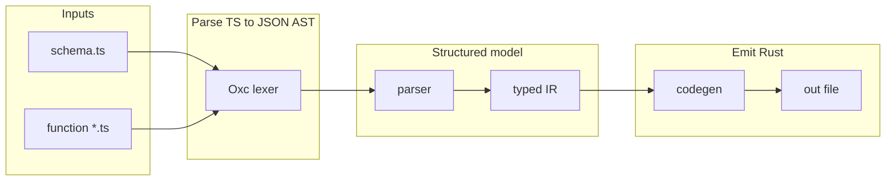

# convex-typegen — architecture

This document is for **contributors** who want to understand how the crate works end-to-end, where to change behavior, and what invariants must hold when improving parsing or codegen.

## Goals and constraints

- **Run at build time** (`build.rs`): read Convex TypeScript (`schema.ts` + function modules), emit a single Rust file to `$OUT_DIR/convex_api.rs` by default.
- **Stay dependency-light on the codegen path**: no `syn` / `quote` for output; Rust text is built with string formatting.
- **Stable public API**: small generator surface (`generate`, `Configuration`, `prelude`) and a separate runtime crate. Almost everything interesting lives under the private `convex` module.

---

## End-to-end pipeline

High-level flow from [generate()](https://docs.rs/convex-typegen/latest/convex_typegen/fn.generate.html):

1. **`config::Configuration`** — Paths for schema, output file, Convex directory, optional explicit `function_paths`, and optional authoritative `function_spec_path`.
2. **`fs::function_source_paths`** — Discovers TypeScript endpoint inputs when neither a spec nor an explicit source list is configured. `build::generate` tracks the selected inputs and relative imports from the parsed source graph.
3. **`convex::create_function_asts`** — Canonicalizes each input and follows named relative imports; schema and function inputs share this loader. ASTs are stored in a **`BTreeMap<String, JsonValue>`** keyed by canonical path string (stable iteration order, no basename collisions between `convex/a/foo.ts` and `convex/b/foo.ts`).
4. **Function adapters** — The TypeScript parser uses Oxc/ESTree and the bounded static binding/spread resolver; the committed function-spec adapter validates JSON and lowers it directly to the same IR.
5. **`ir::GenerationIr`** — Source-neutral typed model: validator trees, canonical module path + export identity, function kind/visibility, explicit declared/unknown metadata, field presence, and source provenance with optional offsets.
6. **`codegen::generate_code`** — Matches on `GenerationIr` directly and builds generated Rust in memory; the writer validates first and then atomically renames a same-directory temporary file.

Errors are unified as **`ConvexTypeGeneratorError`** (IO, Oxc parse/semantic failures, invalid schema shape, invalid `v.*` names, etc.).

---

## Crate map (where to look)

| Area | Module / path | Responsibility |
|------|-----------------|------------------|
| Entry | `src/lib.rs` | `generate` and crate docs |
| Config | `src/config.rs` | `Configuration` defaults |
| Discovery | `src/fs.rs` | Walk `convex/**/*.ts`, skip schema / `_generated` / `node_modules` / reserved modules / `*.d.ts`, for TypeScript discovery |
| Function spec | `src/convex/spec.rs` | Validate function-spec JSON and lower it directly to the shared IR |
| TS → JSON AST | `src/convex/lexer.rs` | Oxc parse + semantic check → `to_estree_ts_json` → `serde_json::Value` |
| ESTree → IR | `src/convex/parser.rs` | Schema and function extraction, including inline argument and return validators |
| IR types | `src/convex/ir.rs` | Schema, table documents, fields, functions, and provenance |
| Naming | `src/convex/utils.rs` | Normalize Rust type and field identifiers |
| Validator IR | `src/convex/validator.rs` | `ConvexValidator`, typed literal values and record key kinds |
| Oxc AST spike | `src/convex/ast.rs` | Direct `Program` walks for future JSON-path replacement (not on the production path) |
| Rust text | `src/convex/codegen.rs` | Named object structs, tables, union enums, and Serde-enabled `*Args` structs |
| Source loading | `src/convex/mod.rs` | `create_schema_ast`, `create_function_asts` |

---

## Phase 1 — TypeScript to ESTree JSON (`lexer.rs`)

### Why Oxc and not `tsc`?

The build must be **self-contained in Rust**: Oxc parses TypeScript/TSX, runs semantic checks, and can serialize the program to **ESTree-compatible JSON**. The ESTree adapter consumes that JSON.

### Steps in `generate_javascript_ast`

1. Read source text; reject whitespace-only files (`EmptySchemaFile`).
2. **`SourceType::from_path`** — Infer TS vs TSX from extension; failure becomes `ParsingFailed`.
3. **Parser** — Collect diagnostics; if the parser **panicked**, return `ParsingFailed` with joined messages.
4. **Empty program** — Treated like empty file (`EmptySchemaFile`) for the “nothing to work with” case.
5. **`SemanticBuilder`** — `with_check_syntax_error(true)`; any semantic/syntax errors → `ParsingFailed` with joined Oxc diagnostics (and optional **`verbose`** feature to `eprintln!` full debug).
6. **`Program::to_estree_ts_json(false)`** — Oxc’s `Program` is not `Serialize`; this produces a JSON string, then **`serde_json::from_str`** turns it into `serde_json::Value`. Failures become `SerializationFailed`.

Files larger than **`lexer::MAX_SOURCE_BYTES`** (10 MiB) are rejected before parsing.

### Contributor notes

- **ESTree dialect**: Oxc may emit node kinds that differ from older Babel-centric tools (e.g. object literal fields as **`Property`** vs **`ObjectProperty`**). The parser must accept both where we match on `type` (see `parser::is_estree_object_property_like` and function `args` handling).
- **Switching `to_estree_js_json` vs `to_estree_ts_json`**: There is an in-code TODO; changing this is a compatibility risk—run the full test suite and real Convex projects before/after.

---

## Phase 2 — ESTree JSON to internal model (`parser.rs`)

The parser does **not** use a typed ESTree crate. It uses **ad hoc `serde_json::Value` indexing** (`ast["body"]`, `node["type"]`, …). That keeps dependencies low but means:

- Shape assumptions must match **Oxc’s JSON** exactly.
- When Oxc upgrades, **diff representative AST JSON** (or add regression tests with minimal synthetic trees—see existing unit tests).

### Schema (`parse_schema_ast`)

**Expected shape (conceptually):**

- Root: object with `"body": [ ... ]` (program statements).
- Find a **`CallExpression`** whose callee is the identifier **`defineSchema`**:
  - Either under `ExportDefaultDeclaration.declaration`, or as a top-level call (see `find_define_schema`).
- First argument: **`ObjectExpression`** whose `properties` are **tables**.
- Each table property’s `value`: a **`CallExpression`** chain whose base is **`defineTable`**, optionally followed by Convex builder calls (`.index`, `.searchIndex`, `.vectorIndex`). The parser peels that chain to the inner `defineTable` and lowers its first argument to an object or a union of document objects.
- A document object can be written as a property map or as `v.object(...)`. Table union members
  must be required document objects or nested unions of document objects. Earlier top-level
  `const` bindings in the same file can supply validators and property maps.

The adapter lowers the Convex 1.49.0 validator factories into `ConvexValidator`. The numeric aliases
share their respective float64 and int64 nodes. Commit timestamps use the int64 value kind and
`v.nullable(x)` uses a required union of `x` and null. Function handles carry optional kind,
argument and return metadata. Record keys accept string validators, IDs, and unions of those
validators. Static string keys and literal values retain their wire spelling and kind. Malformed
or unsupported validator expressions report a file and byte span. The bounded offline resolver
supports same-file constants, named relative imports, and object spreads; it never evaluates
TypeScript.

### Functions (`parse_function_ast`)

- Canonical source paths are ordered deterministically. Module identity is the path relative to
  `convex_dir`, without the extension, so `users:list` and `admin/users:list` stay distinct. An
  explicitly listed file outside `convex_dir` has `module: None`; place it under the configured root
  to give it a Convex module identity.
- Only named imports of the six query, mutation, action, and internal builders from `convex/server`
  or a generated server module are recognized. Aliases are honored. Exported calls from other
  bindings, including member calls, are ignored.
- HTTP, cron, app-config, generated, and declaration files are not endpoint sources. Helper modules
  contribute endpoints only when they export a recognized builder.
- The first call argument is the config. `args` and `returns` retain `Declared` versus `Unknown` in
  the IR. Static local consts, named relative imports, and object spreads are resolved without
  evaluating TypeScript. Resolution stops at 64 references or spread levels and reports cycles and
  unsupported dynamic expressions with the source file and byte span.

**ESTree detail — `args` fields**

Function parameter object entries may be **`ObjectProperty`** or **`Property`**. Both must be accepted; otherwise codegen fails on valid Oxc output with “Invalid argument property structure”.

### Errors

Most failures are **`InvalidSchema { context, details }`**. When extending the parser, prefer **specific `details` strings** so `build.rs` panics are actionable.

---

## Phase 3 — Intermediate representation (`ir.rs`, `validator.rs`)

| Type | Role |
|------|------|
| `GenerationIr` | Schema and ordered functions supplied to codegen |
| `Schema`, `TableDocument`, `TableShape` | Ordered tables with object fields or union branches |
| `Field` | Name, validator, and provenance, with presence derived from the optional wrapper |
| `Function` | Module and export identity, kind, visibility, argument and return metadata |
| `ConvexValidator` | Recursive validator tree with typed literals and ID targets |
| `Declared<T>` | Separates unknown metadata from known values such as an empty args object or `v.any()` |
| `Provenance` | Source identifier and optional byte offsets for diagnostics |

Explicit function paths outside the configured Convex root have an unknown canonical module path.
Oxc provides byte spans for schemas, tables, fields, functions, parameters, and resolved returns.

## Phase 4 — Code generation (`codegen.rs`)

The emitter walks the IR and builds Rust source in memory. It claims each emitted identifier
within its scope and reports both origins on a collision. The output file is written after model
generation succeeds. Naming and wire behavior are documented in [generated models](https://ctg.jamallyons.com/docs/generated-models.html).

Tables supply document shapes with system fields and associated table markers. The emitter
groups public functions by canonical path under `api` and emits scoped args and returns
alongside runtime `FunctionRef` constants. Matching document validators reuse the
associated document type. Object models reject unknown fields, and union decoders dispatch by a
required distinct literal field when available. Other unions try members in declaration order
using the runtime codec so branch selection preserves wire kinds.

## Runtime crate (`runtime/`)

Generated Rust uses runtime model types and the runtime’s [`ConvexValue` derive](https://ctg.jamallyons.com/docs/macros.html).
The derive lives in `macros/` and expands Rust model definitions into Serde implementations
that use the direct value codec. The macro crate has no dependency on the generator or Oxc. The generator and runtime share a workspace lockfile. The runtime owns the Convex client
dependency, and its Rust 1.85 check selects only the runtime package.

- **`TypedClient`** borrows the official client, encodes arguments into a Convex object, and decodes call results and subscription updates. See [typed client](https://ctg.jamallyons.com/typed-client.html).

### Direct Convex value Serde (`runtime/src/value_serde.rs`)

`value_serde::{to_value, from_value}` serializes and deserializes directly against the official
`convex::Value`, without passing through JSON. This preserves `Int64` versus `Float64` (including
integral floats, signed zero, infinities, and NaN), bytes via `value_serde::Bytes`, and recursive
arrays and objects. Integer values outside Convex's signed 64-bit range and non-string map keys
return errors that include the failing value path. The generated field presence hook wraps every
present value in `Some` after decoding it. Omitted optional fields default to `None` and are
skipped during serialization. `model::RawValue` provides Serde support for the SDK value.

Generated references carry type information for use with the official **`convex`** crate at runtime.
Generation remains offline.

---

## Cargo workspace

The generator package lives at the repository root. The runtime, examples, and `xtask` share
the root `Cargo.lock`, `target/`, and profiles. Use `cargo build --workspace --all-features` and
`cargo test --workspace --all-features` from the root to build and test every member. The examples
run their offline build scripts when built. Use `cargo +1.85 check --locked -p convex-typegen-runtime`
to check the runtime at its own MSRV.

## Testing strategy (for contributors)

- **Unit tests** live next to modules under `#[cfg(test)]` and cover:
  - Synthetic ESTree input and an Oxc-backed fixture that verifies spans and function metadata.
  - Lexer edge cases (empty file, invalid TS).
  - Codegen output (Serde models, `convex_type_to_rust_type` cases).
- **Integration tests** in `tests/golden_generate.rs` and `tests/build_script_smoke.rs` run the full pipeline in `tempfile` directories with inline TypeScript fixtures.
- **SDK parity** compares the v1 review fixture's inline validators against
  `tests/fixtures/v1-review/inline-function-spec.json`. Refresh it from an explicit local
  self-hosted capture using the steps in [the v1 review](v1-review.md#docker-and-cli). Project
  the capture to `identifier`, `args` and `returns`, keeping entries with an identifier
  except `admin/users.js:echo`, and sort by identifier.
- **Golden snapshots** (`insta`) guard stable codegen output for minimal schema/function and cross-module duplicate exports.

When changing parser assumptions, **add or adjust a minimal JSON fixture** in tests before touching production code when possible.

---

## Common extension points

| Goal | Likely touch points |
|------|---------------------|
| New Convex `v.*` validator | `parse_validator`, shared validator IR, emitter mapping when needed, tests |
| New AST shape from Oxc | `lexer` (if serialization changes), `parser` field access, tests |
| Different Rust mapping for objects / unions | `codegen::convex_type_to_rust_type`, enum emission |
| Named nested object structs | `parser` `structName`, `validator.rs`, `codegen::collect_named_structs` |
| Optional / null semantics elsewhere | Any new `TryFrom` or serde paths must align with Convex validation rules |

---

## Related files

- **`readme.md`** — User-facing setup (also included in rustdoc via `lib.rs`).
- **`CHANGELOG.md`** — Notable behavior changes (e.g. named `v.object` structs, optional-arg omission in `TryFrom`).
- **`docs/semver-policy.md`**, **`docs/api-stability.md`** — versioning and public-API contract.
- **`docs/oxc-ast-evaluation.md`** — JSON vs direct Oxc AST tradeoffs.

If you add major pipeline stages, update this document so the next contributor does not have to reconstruct intent from git history alone.
