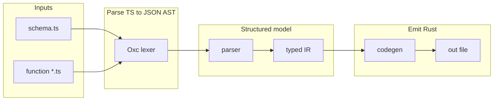

# convex-typegen — architecture

This document is for **contributors** who want to understand how the crate works end-to-end, where to change behavior, and what invariants must hold when improving parsing or codegen.

## Goals and constraints

- **Run at build time** (`build.rs`): read Convex TypeScript (`schema.ts` + function modules), emit a single Rust file (default `src/convex_types.rs`).
- **Stay dependency-light on the codegen path**: no `syn` / `quote` for output; Rust text is built with string formatting.
- **Stable public API**: small generator surface (`generate`, `Configuration`, `prelude`) and a separate runtime crate. Almost everything interesting lives under the private `convex` module.

---

## End-to-end pipeline

High-level flow from [generate()](https://docs.rs/convex-typegen/latest/convex_typegen/fn.generate.html):

1. **`config::Configuration`** — Paths for schema, output file, Convex directory, and optional explicit `function_paths` (skips directory discovery).
2. **`fs::rcfp`** — Resolves which `.ts` files are treated as function sources (same set as `generate`, intended for `cargo:rerun-if-changed`).
3. **`convex::create_schema_ast`** — One file: canonical `schema_path` → ESTree JSON (`serde_json::Value`).
4. **`convex::create_function_asts`** — Many files: each path is canonicalized; ASTs are stored in a **`BTreeMap<String, JsonValue>`** keyed by **canonical path string** (stable iteration order, no basename collisions between `convex/a/foo.ts` and `convex/b/foo.ts`).
5. **`parser::parse_schema_ast`** / **`parser::parse_function_ast`** — Oxc/ESTree adapter that interprets Convex syntax.
6. **`ir::GenerationIr`** — Source-neutral typed model: validator trees, canonical module path + export identity, function kind/visibility, explicit declared/unknown metadata, field presence, and source provenance with optional offsets.
7. **`codegen::run_codegen`** — Matches on `GenerationIr` directly and writes generated Rust.

Errors are unified as **`error::ConvexTypeGeneratorError`** (IO, Oxc parse/semantic failures, invalid schema shape, invalid `v.*` names, etc.).

---

## Crate map (where to look)

| Area | Module / path | Responsibility |
|------|-----------------|------------------|
| Entry | `src/lib.rs` | `generate` and crate docs |
| Config | `src/config.rs` | `Configuration` defaults |
| Discovery | `src/fs.rs` | `rcfp`, walk `convex/**/*.ts`, skip schema / `_generated` / `node_modules` / `*.d.ts` |
| TS → JSON AST | `src/convex/lexer.rs` | Oxc parse + semantic check → `to_estree_ts_json` → `serde_json::Value` |
| ESTree → IR | `src/convex/parser.rs` | Schema and function extraction, including inline argument and return validators |
| IR types | `src/convex/ir.rs` | Schema, table documents, fields, functions, and provenance |
| Naming | `src/convex/utils.rs` | `capitalize_first_letter`, `to_pascal_case`, nested object struct names |
| Validator IR | `src/convex/validator.rs` | `ConvexValidator`, typed literal values, and the nesting depth cap for named objects |
| Oxc AST spike | `src/convex/ast.rs` | Direct `Program` walks for future JSON-path replacement (not on the production path) |
| Rust text | `src/convex/codegen.rs` | Named object structs, tables, union enums, and Serde-enabled `*Args` structs |
| Source loading | `src/convex/mod.rs` | `create_schema_ast`, `create_function_asts` |

---

## Phase 1 — TypeScript to ESTree JSON (`lexer.rs`)

### Why Oxc and not `tsc`?

The build must be **self-contained in Rust**: Oxc parses TypeScript/TSX, runs semantic checks, and can serialize the program to **ESTree-compatible JSON**. The ESTree adapter consumes that JSON.

### Steps in `generate_javascript_ast`

1. Read source text; reject whitespace-only files (`EmptySchemaFile`).
2. **`SourceType::from_path`** — Infer TS vs TSX from extension; failure becomes `ParsingFailed`.
3. **Parser** — Collect diagnostics; if the parser **panicked**, return `ParsingFailed` with joined messages.
4. **Empty program** — Treated like empty file (`EmptySchemaFile`) for the “nothing to work with” case.
5. **`SemanticBuilder`** — `with_check_syntax_error(true)`; any semantic/syntax errors → `ParsingFailed` with joined Oxc diagnostics (and optional **`verbose`** feature to `eprintln!` full debug).
6. **`Program::to_estree_ts_json(false)`** — Oxc’s `Program` is not `Serialize`; this produces a JSON string, then **`serde_json::from_str`** turns it into `serde_json::Value`. Failures become `SerializationFailed`.

Files larger than **`lexer::MAX_SOURCE_BYTES`** (10 MiB) are rejected before parsing.

### Contributor notes

- **ESTree dialect**: Oxc may emit node kinds that differ from older Babel-centric tools (e.g. object literal fields as **`Property`** vs **`ObjectProperty`**). The parser must accept both where we match on `type` (see `parser::is_estree_object_property_like` and function `args` handling).
- **Switching `to_estree_js_json` vs `to_estree_ts_json`**: There is an in-code TODO; changing this is a compatibility risk—run the full test suite and real Convex projects before/after.

---

## Phase 2 — ESTree JSON to internal model (`parser.rs`)

The parser does **not** use a typed ESTree crate. It uses **ad hoc `serde_json::Value` indexing** (`ast["body"]`, `node["type"]`, …). That keeps dependencies low but means:

- Shape assumptions must match **Oxc’s JSON** exactly.
- When Oxc upgrades, **diff representative AST JSON** (or add regression tests with minimal synthetic trees—see existing unit tests).

### Schema (`parse_schema_ast`)

**Expected shape (conceptually):**

- Root: object with `"body": [ ... ]` (program statements).
- Find a **`CallExpression`** whose callee is the identifier **`defineSchema`**:
  - Either under `ExportDefaultDeclaration.declaration`, or as a top-level call (see `find_define_schema`).
- First argument: **`ObjectExpression`** whose `properties` are **tables**.
- Each table property’s `value`: a **`CallExpression`** chain whose base is **`defineTable`**, optionally followed by Convex builder calls (`.index`, `.searchIndex`, `.vectorIndex`). The parser peels that chain to the inner `defineTable` and lowers its first argument to an object or a union of document objects.
- A document object can be written as a property map or as `v.object(...)`. Table union members
  must be required document objects or nested unions of document objects. Earlier top-level
  `const` bindings in the same file can supply validators and property maps.

The adapter lowers the Convex 1.49.0 validator factories into `ConvexValidator`. The numeric aliases
share their respective float64 and int64 nodes. Commit timestamps use the int64 value kind and
`v.nullable(x)` uses a required union of `x` and null. Function handles carry optional kind,
argument and return metadata. Record keys accept string validators, IDs, and unions of those
validators. Static string keys and literal values retain their wire spelling and kind. Malformed
or unsupported validator expressions report a file and byte span. Cross-file bindings, spreads
and dynamically computed validator expressions require the planned offline resolver or function
spec adapter.

### Functions (`parse_function_ast`)

- The canonical source paths in the input `BTreeMap` give deterministic order. The adapter derives
  each module path from its source path relative to the configured Convex root.
- The parser walks exported variable declarations initialized by a call. It records query, mutation,
  or action kind and public or internal visibility from the callee. Other callees retain unknown
  kind and visibility under the existing discovery rules.
- The first call argument is the config. A supported inline `args` object becomes ordered fields.
  An inline `returns` validator is parsed as metadata for future consumers. Absent returns and returns named by an unresolved identifier are unknown. Unsupported
  inline validator calls report an error.

**ESTree detail — `args` fields**

Function parameter object entries may be **`ObjectProperty`** or **`Property`**. Both must be accepted; otherwise codegen fails on valid Oxc output with “Invalid argument property structure”.

### Errors

Most failures are **`InvalidSchema { context, details }`**. When extending the parser, prefer **specific `details` strings** so `build.rs` panics are actionable.

---

## Phase 3 — Intermediate representation (`ir.rs`, `validator.rs`)

| Type | Role |
|------|------|
| `GenerationIr` | Schema and ordered functions supplied to codegen |
| `Schema`, `TableDocument`, `TableShape` | Ordered tables with object fields or union branches |
| `Field` | Name, validator, and provenance, with presence derived from the optional wrapper |
| `Function` | Module and export identity, kind, visibility, argument and return metadata |
| `ConvexValidator` | Recursive validator tree with typed literals and ID targets |
| `Declared<T>` | Separates unknown metadata from known values such as an empty args object or `v.any()` |
| `Provenance` | Source identifier and optional byte offsets for diagnostics |

Explicit function paths outside the configured Convex root have an unknown canonical module path.
The emitter uses the legacy basename for generated args names and `FUNCTION_PATH`. Oxc provides
byte spans for schemas, tables, fields, functions, parameters, and resolved returns. The current
emitter uses `ConvexJsonValue` for union table documents and `String` for opaque function handles.
Typed union documents, literal models, and Rust field names for quoted wire keys are tracked in #40.

---

## Phase 4 — Code generation (`codegen.rs`)

### Design

- **String concatenation** into a `String` buffer, then write file. No proc-macro / `syn` pipeline.
- Emitted file starts with a **fixed header**: allows, `use convex_typegen_runtime::prelude::*`, etc.

### Emission order (`run_codegen`)

1. **`collect_named_structs` / `emit_named_struct_definitions`** — Two-pass: gather `v.object` shapes with a `struct_name` hint from the parser, dedupe by name + field types, emit `pub struct` with serde derives first.
2. **`generate_table_enums`** — For each column that is `v.union` (or `v.optional(v.union(...))`), emit a Rust `enum` **before** table structs so types are in scope.
3. **`generate_table_code`** — `pub struct {Table}Table { ... }` with fields derived from `convex_type_to_rust_type`.
4. **`generate_function_code`** — For each `Function`, emit `{Module}{Export}Args` (see naming below), `FUNCTION_PATH`, and Serde derives. `ConvexClientExt::prepare_args` serializes those structs directly to Convex values. Duplicate qualified struct names return **`InvalidSchema`**.

### `convex_type_to_rust_type`

Maps typed `ConvexValidator` nodes to Rust type strings used in generated source:

- Scalars: `string` → `String`, `number` → `f64`, `boolean` → `bool`, etc.
- **`v.object`**: When the parser attached **`struct_name`**, emit that struct type. Otherwise, if all property types are identical, emit `BTreeMap<String, T>`; if heterogeneous or empty, emit **`ConvexJsonValue`**. Conflicting shapes under the same `struct_name` fail codegen with **`InvalidSchema`**.
- **`v.optional`**: `Option<...>`; if inner is **`union`** and table/field context is known, use generated enum name `{Table}Optional{Field}` for optional unions.
- **`v.union`**: Enum name `{Table}{Field}` (see codegen module docs for collision avoidance).

### Function args — Convex `v.optional` vs JSON `null`

Convex treats **`v.optional`** as “key may be **absent**”, not “key may be **`null`**”. Serde’s `Option::None` serializes to JSON `null` by default, which **fails Convex validation**.

Generated optional args and named-object fields use `#[serde(skip_serializing_if = "Option::is_none")]`.
The runtime codec preserves this omission when serializing to Convex values.

### Naming (`utils.rs`)

- **`function_args_struct_name`**: `{Module}{Export}Args` unless the export already starts with the PascalCase module segment (`tasks` + `tasksSearch` → `TasksSearchArgs`; `games` + `getGame` → `GamesGetGameArgs`).
- **Nested object structs**: `schema_column_object_struct_name`, `function_args_struct_stem` + param field, `nested_object_struct_name` for deeper nesting (depth capped by `validator::MAX_OBJECT_NEST_DEPTH`).
- **`capitalize_first_letter`**: table/field → struct/enum name segments (`games` → `Games`).
- **`to_pascal_case`**: module file segments and union variants (`mod_a` → `ModA`, `draft` → `Draft`).

See [semver-policy.md](semver-policy.md) for when generated type renames require a crate version bump. Keep naming **stable** and **collision-free** when changing algorithms—users rely on generated type names in application code.

---

## Runtime crate (`runtime/`)

Generated Rust uses the runtime prelude and runtime Serde re-exports. The generator and runtime have independent dependency graphs and lockfiles.

- **`ConvexClientExt::prepare_args`** — Serde args struct → `BTreeMap<String, convex::Value>` through `value_serde`; conversion errors carry the failing value path.

### Direct Convex value Serde (`runtime/src/value_serde.rs`)

`value_serde::{to_value, from_value}` serializes and deserializes directly against the official
`convex::Value`, without passing through JSON. This preserves `Int64` versus `Float64` (including
integral floats, signed zero, infinities, and NaN), bytes via `value_serde::Bytes`, and recursive
arrays and objects. Integer values outside Convex's signed 64-bit range and non-string map keys
return errors that include the failing value path. Generated optional args and named-object fields
skip outer `None`; use `Option<Option<T>>` to encode explicit `Value::Null` as `Some(None)`. The
generated `TryFrom` conversion and the lossy `IntoConvexValue` / `ConvexValueExt` APIs have been
removed. `ConvexBytes` fields use the byte-string Serde contract instead of serializing as integer
arrays.

`generate` itself does **not** use the Convex network client; `ConvexClientExt` bridges generated
args to the official **`convex`** crate at runtime.

---

## Testing strategy (for contributors)

- **Unit tests** live next to modules under `#[cfg(test)]` and cover:
  - Synthetic ESTree input and an Oxc-backed fixture that verifies spans and function metadata.
  - Lexer edge cases (empty file, invalid TS).
  - Codegen output (`prepare_args`-ready serde models, `convex_type_to_rust_type` cases).
- **Integration tests** in `tests/golden_generate.rs` and `tests/build_script_smoke.rs` run the full pipeline in `tempfile` directories with inline TypeScript fixtures.
- **SDK parity** compares the v1 review fixture's inline validators against
  `tests/fixtures/v1-review/inline-function-spec.json`. Refresh it from an explicit local
  self-hosted capture using the steps in [the v1 review](v1-review.md#docker-and-cli). Project
  the capture to `identifier`, `args` and `returns`, keeping entries with an identifier
  except `admin/users.js:echo`, and sort by identifier.
- **Golden snapshots** (`insta`) guard stable codegen output for minimal schema/function and cross-module duplicate exports.

When changing parser assumptions, **add or adjust a minimal JSON fixture** in tests before touching production code when possible.

---

## Common extension points

| Goal | Likely touch points |
|------|---------------------|
| New Convex `v.*` validator | `parse_validator`, shared validator IR, emitter mapping when needed, tests |
| New AST shape from Oxc | `lexer` (if serialization changes), `parser` field access, tests |
| Different Rust mapping for objects / unions | `codegen::convex_type_to_rust_type`, enum emission |
| Named nested object structs | `parser` `structName`, `validator.rs`, `codegen::collect_named_structs` |
| Optional / null semantics elsewhere | Any new `TryFrom` or serde paths must align with Convex validation rules |

---

## Related files

- **`readme.md`** — User-facing setup (also included in rustdoc via `lib.rs`).
- **`CHANGELOG.md`** — Notable behavior changes (e.g. named `v.object` structs, optional-arg omission in `TryFrom`).
- **`docs/semver-policy.md`**, **`docs/api-stability.md`** — versioning and public-API contract.
- **`docs/oxc-ast-evaluation.md`** — JSON vs direct Oxc AST tradeoffs.

If you add major pipeline stages, update this document so the next contributor does not have to reconstruct intent from git history alone.
